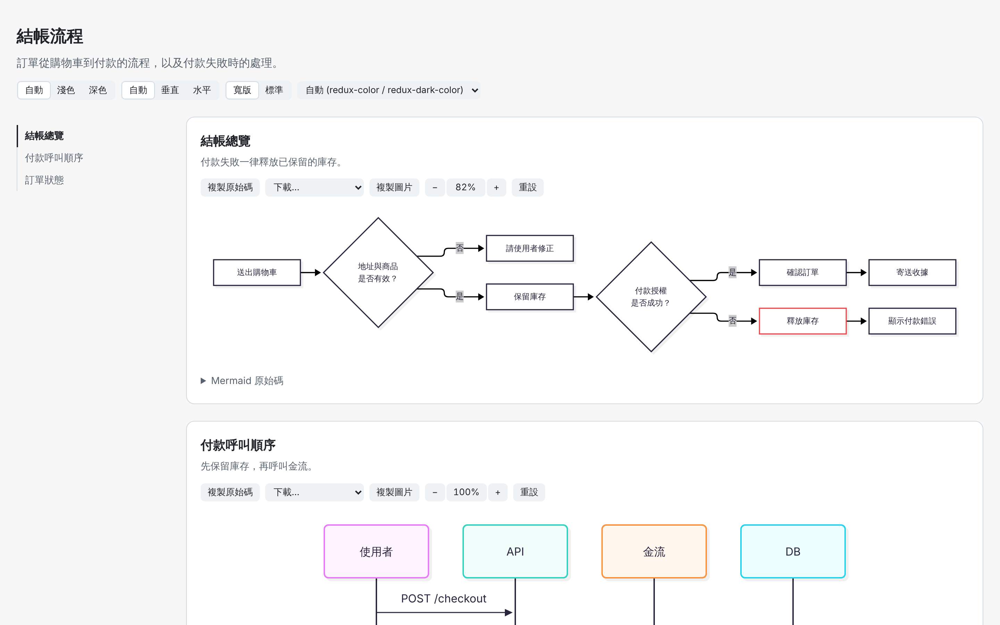

# diagram-first

[English](README.md) | 台灣中文

> 文不如圖。Agent 說明流程、架構、狀態或呼叫順序時，會主動附上圖，幫助你更快理解。

`diagram-first` 是一個 [Agent Skill](https://agentskills.io)。說明內容出現多步驟、分支、元件關係、狀態轉換、呼叫順序、時程或數據比較時，Agent 會主動附圖，不需要你開口；你明確要求畫流程圖、架構圖、sequence diagram 時，也會使用這個 Skill。

> 本專案為個人作品，並非 Anthropic 官方專案。

## 範例

### 對話中的 ASCII

> **你：** 結帳時怎麼決定付款方式？
>
> **Agent：** 已儲存的預設付款方式仍啟用時就用它，否則用第一個啟用的付款方式。
>
> ```text
> 有儲存預設付款方式？
> |
> +- 是 -> 仍啟用？
> |     +- 是 -> 使用
> |     `- 否 -> 使用第一個啟用的方式（顯示提示）
> |
> `- 否 -> 有任何啟用的方式？
>       +- 是 -> 使用第一個啟用的方式
>       `- 否 -> Reject NO_PAYMENT_METHOD
>
> 最後：金額 > 卡片額度 -> Reject LIMIT_EXCEEDED
> ```

### 較大的圖用 HTML

<picture>
  <source media="(prefers-color-scheme: dark)" srcset="docs/images/html-example-zh-tw-dark.png">
  
</picture>

- 淺色／深色模式與 Mermaid Theme
- 橫向螢幕自動轉為水平、縮放與平移
- 下載 SVG／PNG／JPEG／WebP，或複製成圖片
- 兩張圖以上自動產生目錄

## 三種產出方式

```text
              +---------------------+
              | Need a diagram? [1] |
              +---------------------+
                         |
          +--------------+--------------+
          |                             |
          v                             v
 +-----------------+           +-----------------+
 |  Chat     [2]   |           |  Document  [3]  |
 +-----------------+           +-----------------+
     |         |                        |
     v         v                        v
 +-------+ +-------+           +-----------------+
 | ASCII | | HTML  |           | Mermaid block   |
 +-------+ +-------+           +-----------------+
```

圖例：[1] 判斷是否需要附圖；[2] 在對話中說明，依複雜度選擇 ASCII 或 HTML；[3] 寫入 README、ADR、設計文件等。

| 路徑 | 何時使用 | 產出 |
|---|---|---|
| **ASCII** | 對話中的簡單圖：節點 ≤ 5、每個分支出口 ≤ 3、沒有交叉線和回流、單一方向 | 直接放在對話中的 `text` code block，附圖例 |
| **HTML** | 對話中超過 ASCII 上限的複雜圖 | 以 Mermaid 12.1.0(ELK 排版)產生本機 HTML 檔並開啟瀏覽器(見[範例](#範例))；沒有本機檔案系統時，改用 Artifact、傳送檔案，或提供 Mermaid code block |
| **Doc** | 要寫入或更新文件時 | 嵌入 Mermaid code block，只用穩定圖種；依目標平台決定是否附 ASCII 備案 |

不會附圖的情況：只有一兩句話的回答、圖的資訊不比文字多、同一段對話已經畫過相同的圖，或你表示不需要圖。

## 安裝

### Claude Code(plugin marketplace)

```text
/plugin marketplace add puckwang/puck-agent-skills
/plugin install diagram-first@puck-agent-skills
```

更新時執行 `/plugin update diagram-first@puck-agent-skills`。各版本的變更見 [CHANGELOG.zh-tw.md](CHANGELOG.zh-tw.md)。

### claude.ai

1. 到 [Releases](https://github.com/puckwang/diagram-first-skill/releases) 下載原始碼，或 clone 這個 repo。
2. 把 `skills/diagram-first/` 資料夾壓縮成 `diagram-first.zip`。zip 最上層必須是 `diagram-first/` 資料夾。
3. 在 claude.ai 的 Skills 設定頁上傳這個 zip。

### 手動安裝

```bash
git clone https://github.com/puckwang/diagram-first-skill.git
cp -r diagram-first-skill/skills/diagram-first ~/.claude/skills/
```

只想在單一專案中使用的話，改放到該專案的 `.claude/skills/`。

## 檔案結構

```text
skills/diagram-first/
+-- SKILL.md                  入口：觸發條件、路由、產出流程
+-- references/
|   +-- routing.md            輸出目標、交付環境、複雜度上限、拆圖
|   +-- ascii-spec.md         ASCII 規範、樣板、自檢程序
|   +-- mermaid-guide.md      28 種圖種、通用規則、範例、排查
|   `-- doc-embedding.md      文件平台對照、ASCII 備案規則
`-- templates/
    +-- diagram.html          HTML 樣板(Mermaid 12.1.0)
    `-- doc-section.md        文件嵌入樣板
```

repo 根目錄另有 `.claude-plugin/plugin.json`，是透過 marketplace 安裝時使用的 plugin manifest，其中的 `version` 與 release tag、[CHANGELOG.zh-tw.md](CHANGELOG.zh-tw.md) 最新版本一致。`docs/images/` 放本 README 使用的截圖。

這個 Skill 不包含任何 script。Agent 唯一會執行的指令，是開啟瀏覽器顯示 HTML。

## 已知限制

- **sankey 節點名稱只能用 ASCII**：Mermaid 12.1.0 的 sankey 解析器不接受中文等非 ASCII 字元，加引號也無效。遇到這種情況時，Skill 會改用英文節點名稱並在圖例說明，或改用 `flowchart` 呈現。
- **文件平台的 Mermaid 版本由平台決定**：GitHub、GitLab 等平台內建的 Mermaid 通常比較舊，可能不支援 ELK 排版和 beta 圖種。不支援 ELK 時會改用預設排版，不會報錯，但版面可能不同。因此 Doc 路徑只使用穩定圖種。
- **HTML 需要網路**：HTML 檔會從 jsDelivr CDN 載入 Mermaid，離線時無法顯示。
- **Agent 看不到 render 結果**：HTML 頁面上方如果出現錯誤或警告訊息，請回報給 Agent 修正。

## 授權

[MIT](LICENSE)
